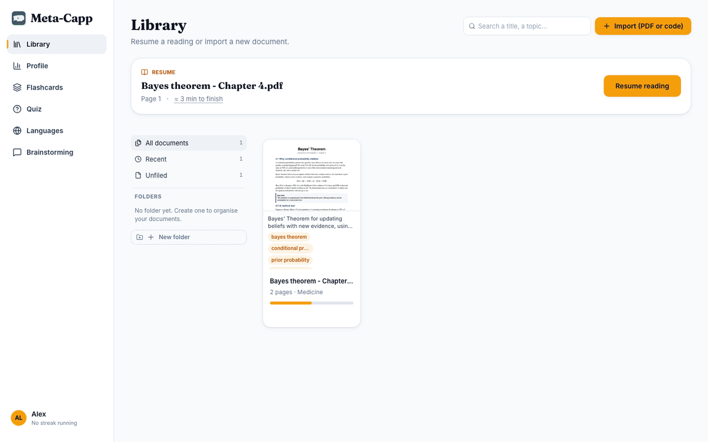
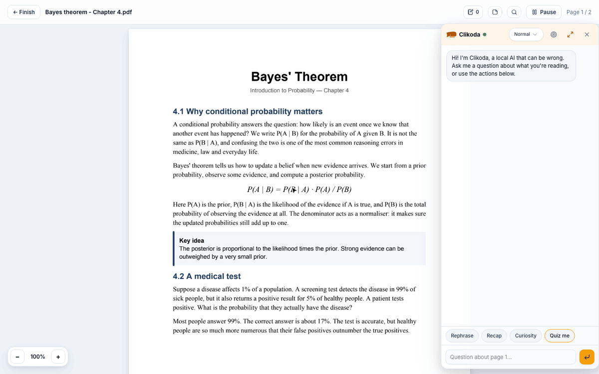

<div align="center">

# Meta-Capp

### Eğitim amaçlı PDF'ler için yapay zekâ temelli bilişsel öğrenme arkadaşı

[English](README.md) · [Français](README.fr.md) · **Türkçe**

**PDF'iniz, yazarının tasarladığı haliyle; yanında nasıl öğrendiğinizi izleyen, bağlama göre yanıt veren ve yalnızca gerçekten işe yaradığında söze karışan canlı bir yapay zekâ okuma arkadaşıyla.**

[](LICENSE)
[](https://github.com/cyyyp100/meta-capp/actions/workflows/ci.yml)
[](https://www.python.org/)
[](https://react.dev/)
[](https://fastapi.tiangolo.com/)
[](https://ollama.com)
[](#yerel-yapay-zekâ-neden-önemli)
[](CONTRIBUTING.md)
[](https://github.com/cyyyp100/meta-capp/releases/latest)
[](https://github.com/cyyyp100/meta-capp/discussions)

[**Neden**](#temel-fikir) · [**Özellikler**](#temel-özellikler) · [**Kurulum**](#kurulum) · [**Mimari**](#teknoloji-yığını) · [**Sürümler**](#sürümler--yerel-ve-pro) · [**Tartışmalar**](https://github.com/cyyyp100/meta-capp/discussions) · [**Katkıda bulunma**](CONTRIBUTING.md)

</div>

---

<div align="center">

|  |  |  |
|:--:|:--:|:--:|
| **📄 Sıfır yeniden yapılandırma** | **🧠 Sessiz bilişsel motor** | **🔒 Hiçbir şey makinenizden çıkmaz** |
| PDF olduğu gibi, tam sadakatle ve serbest kaydırmayla gösterilir. Parçalara bölme yok, yeniden dizgi yok, kilit yok. | Altı gizli gösterge, uyarlanabilir sorular, bilgi kartları ve oturum belleği sayfanın arkasında çalışır. | Ollama ile yerel çıkarım. Hesap yok, telemetri yok, bulut yok, abonelik yok. |

<br>



<sub>Bir pasajı seçin, bağlam olarak ekleyin, sorun. Yanıt, dizüstü bilgisayarda Ollama üzerinden çalışan Gemma 4'ten gelir; bekleme süresi hızlandırılmıştır, ekrandaki rozet de bunu belirtir.</sub>

</div>

---

## Haberler

- **2026-10-27 · v0.2.5** — Clikoda bilgi kartlarınızı haftada bir kez gözden geçirir (siz onaylamadan hiçbir şey değişmez); sınav artık sorular arasında beklemez.
- **2026-10-26 · v0.2.4** — Clikoda ilk mesajından itibaren bir yapay zekâ olduğunu söyler; üçüncü taraf lisansları *Settings ▸ Help ▸ About* içinde.
- **2026-10-23 · v0.2.3** — Clikoda bir yüz kazandı (yeni logonun ispermeçet balinası) ve uygulama kendi simgesine kavuştu.
- **2026-10-21 · v0.2.0** — Clikoda'nın modelini seçin; `qwen3:1.7b` ile 4 GB'lık dizüstü bilgisayarlar için ekonomi modu; okuyucuda arama, yer imleri ve notlar.
- **2026-10-12 · v0.1.0** — Herkese açık beta.

Tüm geçmiş [CHANGELOG](CHANGELOG.md) dosyasında.

---

## Temel fikir

Büyük Dil Modelleri bilgiye erişimi neredeyse zahmetsiz hale getirdi.

**Ama zahmetsiz erişim öğrenme değildir.**

Modern yapay zekâ araçları çoğu zaman şunları teşvik eder:

- pasif tüketimi,
- anında yanıtları,
- zihinsel bağımlılığı,
- yüzeysel anlamayı,
- ve yetkinlik yanılsamasını.

Meta-Capp bunun tam tersi bir felsefeyle geliştirildi.

Çabanın yerine geçmek yerine, yapay zekâyı **çabayı akıllıca yapılandırmak** için kullanır.

“Hızlı yanıtlar” için optimize olmak yerine şunlar için optimize olur:

- kavrama,
- düşünme,
- akılda tutma,
- merak,
- ve üstbilişsel farkındalık.

Amaç öğrenciyi pasif kılmak değil.

**Amaç, öğrencinin daha güçlü bir zihin kurmasına yardım etmek.**

---

## Meta-Capp nedir

Meta-Capp PDF'i yeniden üretmeye ya da yeniden yapılandırmaya çalışmaz. Belge, yazarının tasarladığı haliyle gösterilir — tam sayfalar, serbest kaydırma, kilit yok, bariyer yok.

Değişen, belgenin *çevresindeki* her şeydir:

<table>
<tr>
<td width="50%" valign="top">

### 📖 Serbest kaydırmalı bir okuyucu

PDF'in tamamı, tam sadakatle ve sayfa sayfa aşamalı olarak gösterilir. Kendi hızınızda okursunuz.

</td>
<td width="50%" valign="top">

### 👁️ Bedenlenmiş bir asistan — Clikoda

PDF'in üzerinde küçük, animasyonlu bir balon süzülür. Gözleri var. Siz okurken okur, siz sorarken düşünür, yerel model çevrimdışıyken uyur. Üzerine tıklayıp istediğinizi sorun: yanıt, *Send* tuşuna bastığınız anda görünen sayfaya dayanır — o düşünürken siz başka yere kaydırsanız bile.

</td>
</tr>
<tr>
<td width="50%" valign="top">

### 🧩 Sessiz bir pedagojik motor

Arka planda tüm üstbilişsel sistem çalışmaya devam eder: oturumlar, bilişsel göstergeler, uyarlanabilir sorular, değerlendirilen yanıtlar, otomatik bilgi kartları, oturum sonu değerlendirmesi. Göstergeler artık okuma sırasında gösterilmez — gözünüze sokulmak yerine hesaplanır, kaydedilir ve yapay zekâya beslenir.

</td>
<td width="50%" valign="top">

### ✋ Özerk müdahaleler

Asistan, bir sayfada oyalandığınızı, sürekli ona geri döndüğünüzü, aynı pasaj hakkında tekrar tekrar soru sorduğunuzu ya da matematik yüklü bir duvarla karşılaştığınızı fark eder. Ardından — LLM aracılığıyla — yardım teklif edip etmeyeceğine, pedagojik bir soru sorup sormayacağına, mola önerip önermeyeceğine ya da sayfayı yeniden ifade etmeyi teklif edip etmeyeceğine *karar verir*. Bekleme süreleri onun geveze olmasını önler. *discret* modu onu tamamen susturur; *coach* modu onu daha cesur yapar.

</td>
</tr>
</table>

---

## Bu proje neden var

> **Eğitim amaçlı PDF'ler bilişsel olarak ölü arayüzlerdir.**

- Geleneksel okuyucular sayfaları gösterir.
- Geleneksel sohbet botları soruları bağlamsız yanıtlar.
- Geleneksel RAG hatları metni parçalara böler ve belgeyi kaybeder.

Hiçbiri öğrenenleri anlamaz.

Öğrenme; dikkat, bellek, belirsizlik, düşünme, kafa karışıklığı, yeniden kurma ve çabayı içeren etkin bir bilişsel süreçtir.

Meta-Capp, bu mekanizmaları yapay zekâ çağında yeniden canlandırmak için tasarlandı — **okuyucu ile belge arasına girmeden.**

---

## Farklı bir yapay zekâ felsefesi

Çoğu yapay zekâlı eğitim sistemi sürtünmeyi ortadan kaldırmaya çalışır.

Meta-Capp **üretken sürtünmeyi** getirir — ama asla dayatılan bir sürtünmeyi değil.

Önceki prototipler sayfa çevirmeyi sorulara bağlayıp kilitliyordu. Bu sürüm okuyucuya güvenir: kaydırma serbesttir ve sistem dikkati talep etmek yerine hak eder. Asistan:

- önce görünen sayfadan, sonra genel bilgiden yanıt verir,
- yanıtları değerlendirilen gerçek pedagojik sorular sorar,
- iyi alışverişleri bilgi kartlarına dönüştürür,
- yaptığınız her şeyden bir bilişsel profil günceller,
- ve her oturumu üstbilişsel bir değerlendirmeyle kapatır.

> Yapay zekâ düşünmenin yerini almak için kullanılmaz.
> **Yapay zekâ düşünmeyi geliştirmek için kullanılır.**

---

## Yerel yapay zekâ neden önemli

Meta-Capp tamamen yerelde, **[Ollama](https://ollama.com) üzerinden Gemma 4** ile çalışır.

| ❌ Abonelik yok | ❌ Bulut bağımlılığı yok | ❌ Eğitimde gözetim yok | ❌ Veri toplama yok |
|---|---|---|---|

Eğitim verileri öğrenenin makinesinde kalır: hatalar, şüpheler, zayıflıklar, kafa karışıklığı, merak, düşünceler. **Bunlar bulut ürününe dönüşmemeli.**

Ollama çevrimdışıysa hiçbir şey bozulmaz: okuyucu tamamen kullanılabilir kalır ve asistan gözle görülür biçimde uykuya dalar.

### Herkes için, her yerde eğitim

Eğitime erişim; bir fiber hatta, bir veri paketine ya da bir bulut aboneliğine bağlı olmamalı. Meta-Capp'i kurmak tek bir indirme gerektirir (bu indirme bir makineden diğerine kopyalanabilir) ve sonrasında **hiçbir bağlantıya ihtiyaç duymaz**: ücra bir köyde, bir teknede, şebekenin gelip gittiği bir bölgede, Wi-Fi olmayan bir sınıfta.

Öğretmenlerin az olduğu yerlerde ise sayfayı açıklayan, karşılığında sorular soran ve öğrendiklerinizi bilgi kartlarına dönüştüren sabırlı bir arkadaş gerçek bir fark yaratabilir. Öğretmenlerin yerini almak için değil, yanında öğretmeni olmayan öğrenenlerin yanında durmak için.

Yapay zekâyı yerelde çalıştırmanın getirdikleri:

- **Bağlantı gerekmez** — kesinti yok, istek sınırı yok, ağ gecikmesi yok; uygulama uçakta da evdeki gibi çalışır.
- **Kullanımı ücretsiz** — soru başına maliyet yok, abonelik yok, kota yok.
- **Tasarım gereği gizli** — gönderilecek bir şey olmadığı için sızacak, satılacak ya da eğitimde kullanılacak bir şey de yok. Öğrenenin verisini hiçbir üçüncü taraf işlemez.
- **Mütevazı donanımda çalışır** — 4 GB'lık bir dizüstü bilgisayardan (küçük model, ekonomi modu) bir iş istasyonuna kadar, GPU ile ya da GPU olmadan.
- **Bağımlılık yok** — açık ağırlıklı modeller ve açık kaynak kod: bir sağlayıcı fiyatları, koşulları ya da hizmeti hakkında ne karar verirse versin çalışmaya devam eder.
- **Denetlenebilir** — asistanın yaptığı her şey bu depodadır ve sakladığı her şey, öğrenenin dışa aktarabileceği ya da silebileceği tek bir SQLite dosyasındadır.

### AB Yapay Zekâ Yasası gözetilerek geliştirildi

Meta-Capp, Avrupa Yapay Zekâ Yasası (Tüzük (AB) 2024/1689) doğrultusunda tasarlanmıştır:

- **Şeffaflık** — Clikoda kendini bir yapay zekâ olarak tanıtır ve uygulama yanılabileceğini söyler. Kimse bir insanla konuştuğuna inandırılmaz.
- **Duygu tanıma yok, biyometri yok** — göstergeler okuma davranışından (bir sayfada geçirilen süre, sorular, yanıtlar) çıkarılır. Kamera yok, mikrofon yok, biyometrik veri yok.
- **Kontrol öğrenende kalır** — not yok, kabul ya da yönlendirme kararı yok. Her müdahale kapatılabilir, *discret* modu Clikoda'yı tamamen susturur ve bir duraklatma her şeyi dondurur.
- **Açık ve yerel** — MIT lisanslı kaynak kod, yerel modeller, makineden hiç çıkmayan veriler.

Bu bölüm yazılımın nasıl tasarlandığını anlatır; yasal bir belgelendirme değildir.

---

## Temel özellikler

| Yetenek | Açıklama |
|---|---|
| **Serbest kaydırmalı PDF okuyucu** | Tüm belge, aşamalı yüksek çözünürlüklü sayfa gösterimi, ilerleme kilidi yok |
| **Bedenlenmiş asistan balonu** | Boşta / okuma / düşünme / yanıtlama / müdahale / uyku durumlarına sahip, animasyonlu, sürüklenebilir Canvas karakteri |
| **Gönderim anında bağlam yakalama** | Her soru, Send'e bastığınız anda görünen sayfanın bir anlık görüntüsüne göre yanıtlanır |
| **Özerk müdahaleler** | LLM'in karar verdiği yardım teklifleri, sorular, mola önerileri, sayfa yeniden ifadeleri — genel ve sayfa başına bekleme süreleriyle |
| **Asistan modları** | *discret* (asla ilk konuşmaz), *normal*, *coach* (daha çok müdahale eder) — kullanıcı başına saklanır |
| **Uyarlanabilir soru sorma** | Tam bir soru → yanıt → değerlendirme → geri bildirim → bilgi kartı hattı, engellemeyen yapıda |
| **Seçiminizde hızlı eylemler** | Yeniden ifade et, Özetle, Merak ve Beni sına, bağlam olarak eklediğiniz pasajlarda ya da sayfada çalışır |
| **Beklemeden sınav** | Yazılı yanıtlar arka planda Clikoda tarafından notlandırılır; sonraki soru hemen gelir, düzeltmeler özette bekler |
| **Haftalık bilgi kartı kontrolü** | Clikoda haftada bir kartlarınızı gözden geçirir: yanlış bir yanıt, belirsiz bir soru, yalnızca PDF'in yanında anlam taşıyan bir kart. Siz onaylamadan hiçbir şey değişmez |
| **Gizli bilişsel göstergeler** | Dikkat, kavrama, merak, akılda tutma, yaratıcılık, üstbiliş — hesaplanır ve kaydedilir, asla bunaltmaz |
| **Oturum belleği** | Görülen sayfalar, kalma süresi, geri dönüşler, sayfa başına sorular, saptanan zorluklar |
| **Elle bilgi kartları** | Tek tıkla yararlı bir asistan yanıtı bilgi kartına dönüşür |
| **Zenginleştirilmiş oturum özeti** | Oturum sonu sentezi, en çok yardım istediğiniz sayfaları içerir |
| **Bölüm farkındalığı** | Yapay zekâ ve gezinme çubuğu için meta veri olarak hesaplanan bölüm dizini (içindekiler ya da yazı tipi boyutu sezgileri) |
| **Kaynak kod okuma** | Bir kaynak dosyasını içe aktarın: aynı arkadaşla birlikte okunabilir kod bloklarına bölünür |
| **İki dilli (FR / EN)** | Arayüz *ve* LLM istem dili birlikte değişir, açılışlar arasında saklanır |
| **Tamamen yerel yapay zekâ** | Ollama ile Gemma 4, çevrimdışıyken zarif bir şekilde işlevi azaltma |

---

## Okuma akışı

```
  Import  →  Airlock  →  Flash review  →  Free reading  →  Challenge  →  Synthesis
```

1. **Bir PDF içe aktarın.** Bölüm seçimi yok — oturum belgenin tamamıdır.
2. **Konsantrasyon hava kilidi.** Yapay zekâ üretimi bir merak kancasıyla 30 saniyelik bir yavaşlama ritüeli.
3. **Hızlı tekrar.** Bu belgeden vadesi gelmiş en fazla 5 bilgi kartı.
4. **Özgürce okuyun.** PDF'in tamamı, kaydırılabilir, üzerinde Clikoda süzülürken.
5. **İstediğinizi sorun.** Balona tıklayın, yazın, Enter'a basın. Yanıt, soruyu sorduğunuz sırada bulunduğunuz sayfayı gösterir.
6. **Meydan okunun.** Bazen Clikoda *size* bir soru sorar. Yanıtlayın (değerlendirilir, profilinizi besler, bilgi kartına dönüşebilir) — ya da kapatın.
7. **Oturumu bitirin.** Sentez, üstbilişsel sorular, profil güncellemesi.

<table>
<tr>
<td width="50%" valign="top">

**Okumadan önce** — 30 saniyelik bir hava kilidi, ardından önceki bir oturumdan bir bilgi kartının hızlı tekrarı.


</td>
<td width="50%" valign="top">

**Beni sına** — sayfadan üretilen bir soru, yazılı bir yanıt ve Clikoda'nın geri bildirimi.



</td>
</tr>
</table>

---

## Gemma 4'ün rolü

<table>
<tr><td width="50%" valign="top">

**Bağlamsal yanıtlama**
Kullanıcı sorularını bir `PageContextSnapshot` üzerinden yanıtlar: sayfa metni, hafif bir sayfa görüntüsü, tahmini bölüm, canlı göstergeler ve son alışverişler.

</td><td width="50%" valign="top">

**Müdahale kararları**
Gözlemlenen sinyalleri (kalma süresi, geri dönüşler, düşük dikkat, matematik yoğunluğu, tekrarlanan sorular) alır ve yapılandırılmış bir karar döndürür:
`{should_intervene, kind, message, question}`.

</td></tr>
<tr><td width="50%" valign="top">

**Eğitsel üretim**
Uyarlanabilir sorular, üstbilişsel sinyallerle yanıt değerlendirmesi, yeniden ifadeler, bilgi kartları, merak kancaları.

</td><td width="50%" valign="top">

**Üstbilişsel analiz**
Oturum sonu özetleri, düşünme soruları ve profil güncellemeleri.

</td></tr>
</table>

---

## Bilişsel profil sistemi

Altı gösterge her oturum boyunca gelişir ve uzun vadeli bir profilde birleşir: **bağlamı kavrama, yaratıcılık, akılda tutma, merak, dikkat, üstbiliş** — ayrıca belgelerinizden saptanan konu bazlı düzeyler.

Okuma sırasında görünmezler. Yine de her şeyi yönlendirirler: soru zorluğunu, müdahale eşiklerini, oturum özetlerini ve asistanın tonunu.

---

## Kurulum

Meta-Capp **macOS, Windows ve Linux** üzerinde, GPU ile ya da GPU olmadan çalışır.

### Hızlı başlangıç

1. Sisteminize uygun arşivi [son sürümden](https://github.com/cyyyp100/meta-capp/releases/latest) indirin (yaklaşık 30 ila 45 MB).
2. Açın. Derlemeler **henüz imzalı değildir**, bu yüzden ilk açılışta ek bir adım gerekir:
   - **macOS** — ilk çift tıklama reddedilir. *System Settings ▸ Privacy &
     Security* bölümünü açın, Meta-Capp ile ilgili iletiye kadar kaydırın ve **Open Anyway** düğmesine tıklayın (bir kez).
     macOS bunun yerine uygulamanın *hasarlı* olduğunu söylerse, indirme sırasında imza
     kaybolmuştur: `xattr -dr com.apple.quarantine /Applications/Meta-Capp.app` onu geri getirir.
   - **Windows** — SmartScreen *Windows protected your PC* gösterir: **More info ▸ Run anyway**.
   - **Linux** — bir terminalden `./Meta-Capp/Meta-Capp` komutunu çalıştırın ve açık tutun; uygulama tarayıcınızda açılır.
3. Clikoda için [Ollama](https://ollama.com)'yı kurun ve `ollama pull gemma4:e4b` komutunu çalıştırın (9,6 GB; daha hafif makineler için bkz. [Model indirme](#model-indirme)).

Arşivi `SHA256SUMS.txt` ile doğrulayın (`shasum -a 256 <file>` / `certutil -hashfile <file> SHA256`).

### Gereksinimler

| | Yalnızca uygulama | Clikoda (asistan) ile |
|---|---|---|
| **İşletim sistemi** | macOS (Apple Silicon veya Intel), Windows 10/11 x64, Linux x86_64 (glibc 2.35+) | aynı |
| **RAM** | herhangi yeni bir makine | standart model için **12 GB veya üzeri**; 8 GB hafif modeli, 4 GB ekonomi modunda küçük modeli çalıştırır (aşağıya bakın) |
| **Disk** | ~400 MB | modele bağlı olarak **+1,4 ila 20 GB**, ayrıca isteğe bağlı `embeddinggemma` için 0,6 GB |
| **GPU** | yok | isteğe bağlı — Apple Silicon (Metal), NVIDIA (CUDA), bazı AMD (ROCm); yalnızca CPU ile de çalışır, ama yavaş |

Clikoda isteğe bağlıdır: [Ollama](https://ollama.com) olmadan da okuyucu, bilgi kartları ve
istatistikler çalışır, asistan ise gözle görülür biçimde uykuya dalar.

**Yavaş makineler yalnızca hoş görülmez, hesaba katılır.** Üretim süre bütçeleri, Clikoda'nın
makinenizdeki *ölçülen* hızından türetilir (açılışta kısa bir kalibrasyon çağrısı, sonra her yanıt): yalnızca CPU'lu bir dizüstü bilgisayar
zaman aşımı yerine yavaş yanıtlar alır. Saniyede ~2 token'ın altında (referans Apple Silicon makinesinden 8 kat yavaş),
bütçeler uzamayı bırakır ve uzun yanıtlar ekranı süresiz bekletmek yerine vazgeçer —
ekonomi modunda ~0,9 token/sn'ye kadar, yanıt başına asla çeyrek saatten fazla olmamak üzere. Model belleğe sığmıyorsa okuyucu bunu açıkça söyler.

**Ekonomi modu** (Settings ▸ Clikoda) 4 GB'lık bir dizüstü bilgisayarı kullanılabilir kılan şeydir: model hiç yeniden yüklenmesin diye
her istek için tek bir bağlam, bu bağlama sığan kompakt istemler, arka plan işi yok (belge özetleri, dil bölümleri), kendiliğinden yardım yok, yalnızca sözcüksel
arama, beş dakikalık boşta kalmanın ardından modelin bellekten boşaltılması — ve okuyucu
beklemeyi duyurur (“en fazla N dakika içinde yanıt”) ve bir **Cancel** düğmesi sunar. “Automatic” bunu
küçük modelle ya da 8 GB RAM'in altında açar; her iki yönde de zorlayabilirsiniz.

### Çalıştırmaya hazır derlemeler

Her [sürüm](https://github.com/cyyyp100/meta-capp/releases/latest) platform başına bir
arşiv ve bir `SHA256SUMS.txt` ile gelir:

| Platform | Arşiv | Notlar |
|---|---|---|
| Apple Silicon Mac | `macos-arm64.zip` | `Meta-Capp.app` dosyasını Uygulamalar'a taşıyın, sonra açın |
| Intel Mac | `macos-x86_64.zip` | GitHub'ın son Intel çalıştırıcısında derlendi, Ağustos 2027'ye kadar kullanılabilir |
| Windows 10/11 x64 | `windows.zip` | açılan klasörü bütün tutun; WebView2 kullanır (Windows 11'de ve güncel Windows 10'da yerleşiktir) |
| Linux x86_64 | `linux-x86_64.tar.gz` | bir terminalden `./Meta-Capp/Meta-Capp` komutunu çalıştırın ve açık tutun; tarayıcınızda açılır |

### Model indirme

Clikoda **gemma4** ailesi üzerinde çalışır — ayrıca 4 GB'lık makineler için küçük bir model — ve
hangisinin kullanılacağı sabit kodlanmış bir ad değil, bir ayardır.
« Automatic » (varsayılan), kurulu olanlar arasından makinenizin belleğinin gerçekten yükleyebildiği
**ve üzerinde akıcı kalan** en yetenekli modeli seçer: açılışta ölçülen yazma hızı
15 token/sn'nin altına düşen bir model bir sonraki en iyisi için kenara ayrılır
(bu makinede 14 gün boyunca; eşiğin üzerindeki sonraki bir ölçüm onu geri getirir).
**Settings ▸ Clikoda** neyi seçtiğini, nedenini — hangi modelin ve hangi hızda kenara ayrıldığı dahil — ve
eksik olan her şey için `ollama pull` komutunu gösterir. Açık bir seçim her zaman
dikkate alınır. Tablo `nwol/config/settings.py:LLM_MODELS` içinde yer alır.

| model | indirme | gereken RAM | için |
|---|---|---|---|
| `qwen3:1.7b` | 1,4 GB | 4 GB | 4 GB'lık bir dizüstü: daha yavaş, daha çok hata, yalnızca metin (sayfa görüntüsü yok), ekonomi modu açık |
| `gemma4:e2b` | 7,2 GB | 8 GB | hafif bir makine |
| `gemma4:e4b` | 9,6 GB | 12 GB | standart seçim |
| `gemma4:12b` | 8,0 GB | 12 GB | daha iyi yanıtlar, çok daha yavaş (16 GB'lık Apple M4'te e4b için ~30'a karşılık ~12 token/sn) |
| `gemma4:26b` / `gemma4:31b` | 18–20 GB | 32 GB | bir iş istasyonu |

```bash
ollama pull gemma4:e4b       # or e2b on a lighter machine, qwen3:1.7b on a 4 GB one
ollama pull embeddinggemma   # optional (~600 MB): semantic search inside the document you read
```

> `embeddinggemma` olmadan, Clikoda'nın geçerli belge içindeki araması sözcüksel (BM25) kalır.

### Kaynaktan

**Python 3.11** ve **Node 20+** gerektirir (web arayüzünü derlemek için).

```bash
git clone https://github.com/cyyyp100/meta-capp.git
cd meta-capp

python -m venv .venv
source .venv/bin/activate     # Windows: .venv\Scripts\activate

pip install -r requirements.txt
cd frontend && npm install && cd ..
```

### Başlatma

```bash
python main.py                       # native app window (builds the frontend if needed)
python main.py path/to/document.pdf  # import and open a document directly
python main.py --browser             # open in the default browser instead of a window
python main.py --debug               # DEBUG logging
```

**Yerel pencere yok mu? Tarayıcınızda açılır.** Pencere, yerel bir web
motoru gerektirir: WebKit (macOS), WebView2 (Windows), GTK veya Qt (Linux). Hiçbiri
kullanılamadığında — ya da `--browser` ile — Meta-Capp aynı uygulamayı, aynı
korumalarla, varsayılan tarayıcınızda sunar. Çıkmak için profil
menüsünden **Quit Meta-Capp** seçeneğini seçin ya da sekmeyi kapatmanız yeterli: uygulama, son
sekme kapandıktan üç dakika sonra kendiliğinden durur. Bu durumda bir belgeyi içe aktarmak, veri klasörüne
belgeyle birlikte silinen bir kopya yükler. Çalışırken yeniden başlatmak onu yeniden açar.

<details>
<summary><b>Linux: yerel pencere elde etme</b></summary>

Meta-Capp'in Python ortamının içinde **birini** seçin.

**GTK** (GNOME, Xfce…) önce sistem kitaplıklarını gerektirir:

```bash
# Debian / Ubuntu
sudo apt install libgirepository1.0-dev libcairo2-dev pkg-config python3-dev gir1.2-webkit2-4.1
# Fedora
sudo dnf install gobject-introspection-devel cairo-gobject-devel pkgconf python3-devel webkit2gtk4.1
# Arch
sudo pacman -S gobject-introspection cairo pkgconf webkit2gtk-4.1

pip install "pywebview[gtk]"
```

**Qt** (KDE) yalnızca pip ile kurulur (~200 MB):

```bash
pip install "pywebview[qt]"
sudo apt install libxcb-cursor0   # Debian/Ubuntu, if Qt cannot load the "xcb" plugin
```

Paket adları dağıtımlara göre değişir: başvuru kaynağı
[pywebview kurulum kılavuzudur](https://pywebview.flowrl.com/guide/installation.html).
Pencere yine de açılamazsa Meta-Capp tarayıcıya geçer ve nedenini günlüğe yazar
(`Fenêtre native indisponible : …`).

</details>

<details>
<summary><b>Sorun giderme</b></summary>

- **Clikoda uykuda kalıyor** — Ollama çalışmıyor ya da hiçbir model kurulu değil. **Settings ▸
  Clikoda** hangisi olduğunu söyler, kullanacağı modeli belirtir ve kopyalanacak
  `ollama pull` komutunu verir.
- **Clikoda çok yavaş** — `ollama ps` modelin nerede çalıştığını gösterir (`PROCESSOR`: GPU,
  CPU ya da bölünmüş). CPU'da bu beklenen bir durumdur: okuyucu beklemeyi duyurur ve **Cancel** sunar,
  günlük de açılışta ölçülen hızı yazdırır (`Débit de Clikoda sur
  cette machine`). Daha hafif bir model, ekonomi modu ve bellek tüketen uygulamaları kapatmak yardımcı olur.
- **"Clikoda does not fit in this computer's memory"** — ileti, modelin neye ihtiyaç duyduğunu söyler;
  biraz RAM boşaltın ya da Settings ▸ Clikoda içinden daha hafif bir model seçin (`qwen3:1.7b` 4 GB'tan
  itibaren çalışır). Uygulamanın geri kalanı çalışmaya devam eder.
- **"Le port 8756 est occupé…"** — başka bir program ya da yeniden
  açılamayan bir örnek (eski bir sürüm) portu tutuyor: onu kapatın ya da yeniden başlatın.
- **Bir vekil sunucunun arkasında** (okul ya da şirket ağı) — yapılandırılacak bir şey yok: Meta-Capp
  yerel trafiğini (uygulama, Ollama) asla sistem vekil sunucusundan geçirmez.
- **Günlükler** — Settings → Help → *Report a problem* bunları dışa aktarır; veri klasörünün içindeki
  `logs/` dizininde bulunurlar ([Verileriniz](#verileriniz) bölümüne bakın).

</details>

Geliştirme sırasında arka uç ve ön uç bağımsız çalışabilir:

```bash
cd nwol && python -m server.main     # FastAPI on 127.0.0.1:8756
cd frontend && npm run dev           # Vite on :5173, proxies /api
```

<details>
<summary><b>Masaüstü ikili dosyası paketleme</b></summary>

```bash
pip install -r requirements-build.txt            # pinned PyInstaller
cd frontend && npm run build && cd ..            # build the UI first
pyinstaller desktop/metacapp.spec --noconfirm    # output in dist_app/
```

PyInstaller, üzerinde çalıştığı makinenin mimarisi için derleme yapar: sürüm
iş akışı Apple Silicon, Intel macOS, Windows ve Ubuntu 22.04 çalıştırıcılarında derler
ve her ikili dosyayı duman testinden geçirir. macOS'ta `./scripts/build_app.sh` her iki adımı da yapar,
donmuş ikili dosyayı duman testinden geçirir ve kurar (`--desktop` onu
Masaüstü'ne koyar, `--no-install` yalnızca derler).

</details>

---

## Teknoloji yığını

| Katman | Teknoloji | Rol |
|---|---|---|
| PDF gösterimi | **pypdfium2** (PDFium) | Sayfa gösterimi, sayfa metni, bölüm algılama |
| Anlamsal zekâ | **Ollama ile Gemma 4** | Bağlamsal yanıtlar, müdahaleler, eğitsel akıl yürütme |
| Bilişsel motor | **Özel üstbilişsel sistem** | Göstergeler, profil, düşünme, oturum belleği |
| Arayüz | **pywebview içinde FastAPI + React (Vite)** | Okuyucu, yüzen asistan, istatistikler, bilgi kartları, diller |
| Kalıcılık | **SQLite** | Belgeler, oturumlar, sorular, yanıtlar, göstergeler, bilgi kartları, tercihler |

**Kod tabanının yapısı** — arayüzden bağımsız iş mantığı `nwol/services/` içinde; FastAPI uygulaması ve yönlendiricileri `nwol/server/` içinde; okuyucu bir WebSocket akışıdır; masaüstü kabuğu `desktop/pywebview_main.py` dosyasıdır. Bunu böyle tutan kurallar [CONTRIBUTING.md](CONTRIBUTING.md) içinde belgelenmiştir.

```
meta-capp/
├── main.py               # entry point — launches the desktop app
├── desktop/              # native shell (pywebview) + PyInstaller spec
├── frontend/             # React 18 + Vite + TypeScript UI
└── nwol/
    ├── services/         # ← business logic: the single home for behaviour
    ├── server/           # FastAPI app factory + routers mounted under /api
    ├── llm/              # Ollama client, prompts, JSON schemas
    ├── metacog/          # gauges, long-term profile, reflection
    ├── db/               # SQLite connection + versioned migrations
    ├── config/           # settings — the source of truth for every threshold
    └── tests/            # backend + services suites
```

---

## Doğrulama

```bash
cd nwol && python -m pytest                     # backend suite
cd nwol && ruff check .                         # lint
cd frontend && npm run build && npx vitest run  # type-check, bundle, UI tests
python -m compileall nwol                       # static check
python desktop/pywebview_main.py --server-only  # headless server smoke test
```

CI, her push ve pull request'te arka uç test takımını, ön uç derlemesini ve güvenlik taramalarını (`pip-audit`, `npm audit`, gizli bilgi taraması) çalıştırır.

---

## Sürümler — Yerel ve Pro

**Bu depo eksiksiz yerel sürümdür ve MIT lisansı altında sonsuza dek ücretsizdir.** Kısıtlanmış bir demo değildir: okuyucu, asistan, üstbilişsel motor, göstergeler, bilgi kartları ve oturum belleği burada, hepsi çalışır durumda, hepsi çevrimdışı.

Meta-Capp **Pro**, aynı pedagojiyi daha yetenekli bir yapay zekâyla ve bir GPU'ya sahip olmadan isteyenler için ayrı, barındırılan bir sürümdür.

| | **Yerel** — bu depo | **Pro** — barındırılan |
|---|:--:|:--:|
| Fiyat | **Ücretsiz**, MIT | Abonelik |
| Kurulum | Ollama'yı kurun, bir model indirin | Kurulacak bir şey yok |
| Yapay zekâ modeli | Makinenizde (gemma4 ailesi ya da 4 GB'ta küçük bir model — seçim sizin) | Daha yetenekli barındırılan modeller |
| Zor materyalde yanıtlar ve düzeltmeler | Donanımınızla sınırlı | Daha derin ve daha güvenilir |
| Dil bölümleri (hikâye, ders, yazılı düzeltme) | Makinenizde yazılır, her biri birkaç dakika, arka planda | Çok daha hızlı üretilir |
| GPU'suz / düşük seviye dizüstü bilgisayarda çalışır | İşlevi azalır | ✅ |
| Aynı okuyucu, bilişsel motor, göstergeler, bilgi kartları | ✅ | ✅ |
| Çevrimdışı çalışır | ✅ | ❌ Bağlantı gerekir |
| Verileriniz yerelde kalır | ✅ Her zaman | İşleme uzakta yapılır |

> **Pro ya da erken erişimle ilgileniyor musunuz?**
> Bir [tartışma](https://github.com/cyyyp100/meta-capp/discussions) açın — bakımcıya ulaşmanın en hızlı yolu budur.

Bu depoya yapılan katkılar bu depoda, MIT altında kalır. Uzak bir hizmetle konuşan, bir aboneliği doğrulayan ya da bir özelliği bir plana bağlayan hiçbir şey buraya ait **değildir** — bkz. [CONTRIBUTING.md](CONTRIBUTING.md).

---

## Verileriniz

Meta-Capp'in hakkınızda bildiği her şey, kendi diskinizdeki tek bir SQLite dosyasında durur —
kaynaktan çalışırken `data/nwol.db`, paketlenmişken işletim sisteminin uygulama verisi dizini
(macOS'ta `~/Library/Application Support/Meta-Capp/`, Windows'ta `%APPDATA%\Meta-Capp\`,
Linux'ta `~/.local/share/Meta-Capp/`).

- **Telemetri yok, izleme yok, otomatik çökme raporu yok.**
- **Hesap yok, etkinleştirme yok, girilecek anahtar yok.**
- Uygulama sunucusu `127.0.0.1` üzerinde dinler ve başka yerden gelen her şeyi
  reddeder. Kutudan çıktığı haliyle, uygulamanın açtığı tek bağlantı kendi
  makinenizdeki Ollama'yadır.
- **İsteğe bağlı tek istisna: güncelleme denetimi.** Varsayılan olarak kapalı. Etkinleştirdiğinizde
  (Settings ▸ Updates), *Check now* en son sürüm numarasını okumak için GitHub'ın herkese açık API'sine tek bir istek gönderir —
  tanımlayıcı yok, parametre yok; her web
  isteğinde olduğu gibi GitHub IP adresinizi ve uygulama sürümünü görür. Hiçbir şey otomatik olarak indirilmez ya da
  kurulmaz.
- **Taşınabilirlik**: her şeyi tek tıkla dışa aktarın (Settings ▸ Data ▸ *Export my data*) — kendiniz açabileceğiniz
  standart bir SQLite dosyasıdır.
- **Silme**: bir *Erase everything* düğmesi profili, soruları, bilgi kartlarını,
  belgeleri, günlükleri ve bir yedek geri yüklendiğinde tutulan güvenlik kopyasını siler. Uygulama
  veri klasörünü silmek geri kalanı kaldırır. Başka hiçbir yerde hiçbir şey kalmaz.
- **Günlükler**, dışa aktarana kadar (*Report a problem*) diskinizde kalır. Dosya adlarını
  ve hata izlerini içerir, belgelerinizin metnini asla; ev klasörünüz
  `~` olarak görünür. Herkese açık bir issue'ya eklemeden önce onları okuyun.

Gizlilik politikasının tamamı [PRIVACY.md](PRIVACY.md) içindedir; üçüncü taraf lisanslarının yanında
Settings ▸ Help ▸ About içinden de bağlantısı verilmiştir.

---

## Katkıda bulunma

Issue'lar, fikirler ve pull request'ler memnuniyetle karşılanır — özellikle pedagoji, erişilebilirlik ve PDF uç durumları konusunda.

- **Sorular ve fikirler** [Tartışmalar](https://github.com/cyyyp100/meta-capp/discussions) bölümüne gider: yardım için [Q&A](https://github.com/cyyyp100/meta-capp/discussions/categories/q-a), başkalarının oy verebileceği özellik önerileri için [Ideas](https://github.com/cyyyp100/meta-capp/discussions/categories/ideas).
- **Gerçek bir PDF'te denediniz mi?** [Beta geri bildirim formu](https://github.com/cyyyp100/meta-capp/issues/new?template=beta_feedback.yml) birkaç dakika sürer ve sonraki sürümleri şekillendirir.
- Kurulum, kurallar ve inceleme kontrol listesi için [CONTRIBUTING.md](CONTRIBUTING.md) dosyasını okuyun. Her pull request bakımcı tarafından incelenir ve birleştirilir.
- Katılarak [Davranış Kurallarını](CODE_OF_CONDUCT.md) kabul etmiş olursunuz.
- Bir güvenlik açığı mı buldunuz? Lütfen herkese açık bir issue açmak yerine [SECURITY.md](SECURITY.md) dosyasını izleyin.

Meta-Capp sizinle örtüşüyorsa, **depoya yıldız verin** — onu, için geliştirildiği öğrenenlere ulaştırmanın en ucuz yoludur.

---

## Eğitim felsefesi

Meta-Capp tek bir temel fikir etrafında kuruludur:

> ### Yapay zekâ insanları bilişsel olarak pasif kılmamalı.

Eğitimde yapay zekânın geleceği anında yanıtlar, otomatikleşmiş düşünme ve bağımlılık döngüleri olmamalı. İnsanların daha iyi akıl yürütmesine, daha uzun süre hatırlamasına, daha derin düşünmesine ve zihinsel olarak etkin kalmasına yardım etmeli.

Meta-Capp, yapay zekâ bilişin yerini almak için değil onu güçlendirmek için kullanıldığında — ve yapay zekânın kendisi okuyucu ile sayfa arasında bir duvar yerine belgenin yanında ölçülü, bedenlenmiş bir varlık haline geldiğinde — eğitim yazılımının neye dönüştüğünü araştırır.

---

## Lisans

[MIT Lisansı](LICENSE) altında yayımlanmıştır — © 2026 Cyprien Vial.

Üçüncü taraf bileşenler kendi lisanslarını korur; hepsi ücretsiz ve serbesttir
(MIT, BSD, Apache-2.0, ISC, PSF, yazı tipleri için SIL OFL); tek zayıf copyleft bileşen
`certifi`'dir (MPL-2.0, değiştirilmemiş). PDF motoru, AGPL-3.0 lisanslı olan ve aksi halde bu lisansı
kapalı kaynaklı her türevine dayatacak olan PyMuPDF yerine **pypdfium2**'dir (Apache-2.0 veya
BSD-3-Clause, PDFium'u (BSD-3-Clause) sarmalar). Her sürüm,
`scripts/third_party_notices.py` tarafından üretilen `THIRD_PARTY_NOTICES.txt` dosyasını içerir;
CI de her copyleft ya da lisanssız bağımlılığı reddetmek için bu betiği çalıştırır.

Dil modelleri Meta-Capp'in parçası değildir: Ollama bunları kendi koşulları altında
makinenize indirir (Gemma 4: Apache-2.0; EmbeddingGemma: Gemma Terms of Use).
